<!-- ===================== HEADER ===================== -->

# Mohammed Ferwana

**Sole backend engineer on Sawn** · 387 automated tests · 10-state claim lifecycle · API live on Render

<!-- ===================== ABOUT ===================== -->
## About me

  

 

I build the server side of products: APIs, data models, authentication and the business rules between them. My main stack is **Node.js, Express and MongoDB**, and I am adding **PostgreSQL** to my daily work. I study **Computer Systems Engineering at Al-Azhar University, Gaza** (class of 2027, CGPA 93.3).

<!-- ===================== FEATURED ===================== -->
## Featured work: Sawn

**Motor insurance claims SaaS.** B2B platform for insurance companies. A claim moves from first report to field inspection, review and final decision across a web dashboard and a Flutter field app. I own the backend: API design, data model, tests and deployment.

  

- Multi-tenant REST API on **Node.js, Express 5, MongoDB and Mongoose**, with Joi validation and JWT auth for three roles: Admin, Claims Officer and Field Adjuster.
- **10-state claim lifecycle** with role-guarded transitions and a full audit timeline for every status change.
- **Map-based dispatch:** adjusters ranked by distance to the accident, with a workload cap of 3 active claims. An officer override leaves an audit note.
- Evidence photos and digital signatures on **Cloudinary**, push notifications through **Firebase Cloud Messaging**, PDF claim reports.
- Public claim tracking link, coverage check at intake, loss assessment with deductible rules.
- **387 automated tests across 27 suites.** API deployed on Render, dashboard on Vercel. 4th place at Startup MVP Bootcamp.

<!-- ===================== HOW I BUILD ===================== -->
## How I build APIs

  

- **Layered modules.** Each feature has its own route, validator, controller, service, repository and model.
- **Multi-tenant by default.** `organizationId` comes from the JWT. Cross-tenant access returns `404`, so IDs leak nothing.
- **Race-safe state changes.** One atomic `findOneAndUpdate` checks tenant, expected status and owner in the same query.
- **Predictable contracts.** One response envelope `{ success, data, error, meta }`, camelCase everywhere, exact HTTP status codes.
- **Proof before merge.** Automated tests per feature, feature branches, Conventional Commits and reviewed pull requests.

<!-- ===================== STACK ===================== -->
## Tech stack

<table>
  <tr>
    <td align="center" width="170"><b>Languages</b></td>
    <td></td>
  </tr>
  <tr>
    <td align="center"><b>Backend</b></td>
    <td></td>
  </tr>
  <tr>
    <td align="center"><b>Databases</b></td>
    <td></td>
  </tr>
  <tr>
    <td align="center"><b>DevOps and testing</b></td>
    <td></td>
  </tr>
  <tr>
    <td align="center"><b>Tools</b></td>
    <td></td>
  </tr>
</table>

**Libraries and services I ship with**

**AI-assisted workflow:** I plan and review with Claude and build with Google Antigravity. No change reaches `main` without a real diff and real test output.

<!-- ===================== REPOSITORIES ===================== -->
## Public repositories

  
  
  
  

<!-- ===================== EXPERIENCE ===================== -->
## Experience and more work

<b>Experience and programs</b>: Sawn · TAQAT · SAIOS Academy · GSG · Masar Tech · Areisto Software · IEEEXtreme

 

| Where | Role | Highlights |
| :--- | :--- | :--- |
| **Sawn** (formerly InsurFlow) | Backend Engineer | Owns the full backend of a B2B claims SaaS. 4th place at Startup MVP Bootcamp. |
| **TAQAT** · TeamLine | Backend Developer and Team Lead | 2026 |
| **SAIOS Academy** · SAIOS Technology | Backend Developer | Authentication audit and role-based access review on an LMS backend. |
| **GSG** · Market Ready Developer Program | Team Lead | Resume parsing and profile sync project with Simera. |
| **Masar Tech** | Backend Engineering Bootcamp | Batch 2 |
| **Areisto Software** | Intern | Khireej Qader Program |
| **IEEEXtreme 20.0** | Competitor | 24-hour global programming contest, October 2026 |

<b>Client and private work</b>: PCED CMS · Learning Platform API

 

| Project | What I built | Stack |
| :--- | :--- | :--- |
| **PCED CMS** | Backend for the bilingual (Arabic and English) website of the Palestinian Center for Environmental Development | Node.js, Express, MongoDB, ES Modules |
| **Learning Platform API** | REST API for a learning platform, built on a layered architecture with dependency injection | Node.js, Express |

<!-- ===================== ACTIVITY ===================== -->
## GitHub activity

  
  

 

  <picture>
    <source media="(prefers-color-scheme: dark)" srcset="https://raw.githubusercontent.com/hammoudFerwana/hammoudFerwana/output/snake-dark.svg" />
    <source media="(prefers-color-scheme: light)" srcset="https://raw.githubusercontent.com/hammoudFerwana/hammoudFerwana/output/snake-light.svg" />
    
  </picture>

<!-- ===================== FOOTER ===================== -->

**Let's build something reliable.** Reach me on [LinkedIn](https://www.linkedin.com/in/mohammed-ferwana/) or at [mohammedferwana2@gmail.com](mailto:mohammedferwana2@gmail.com).

